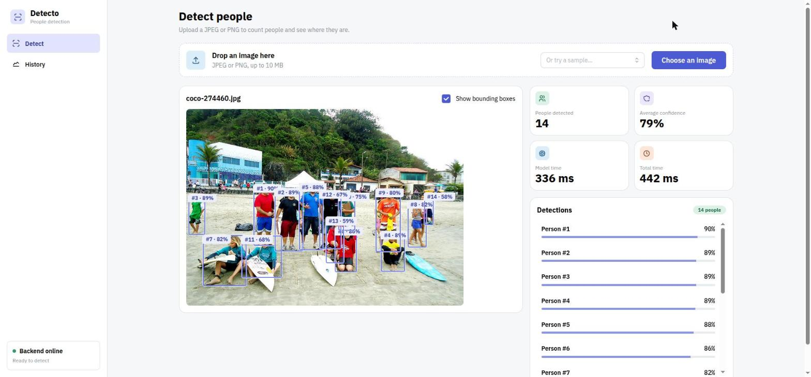
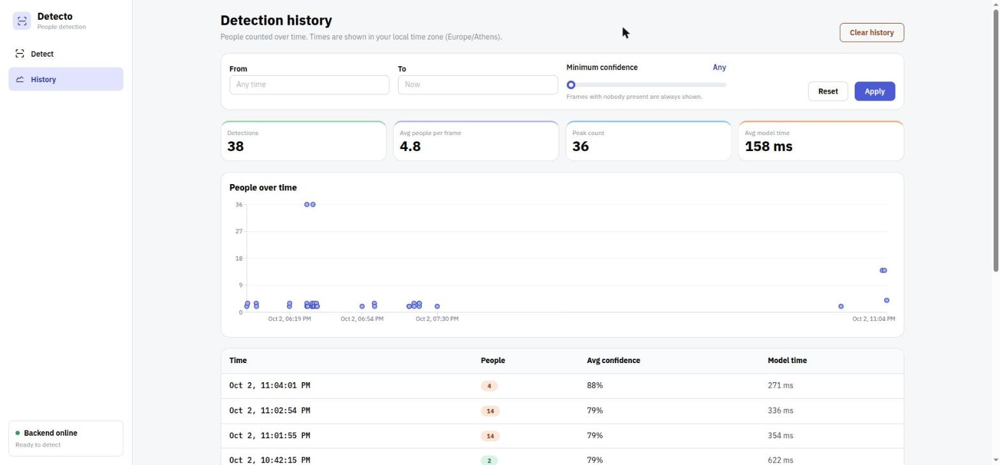
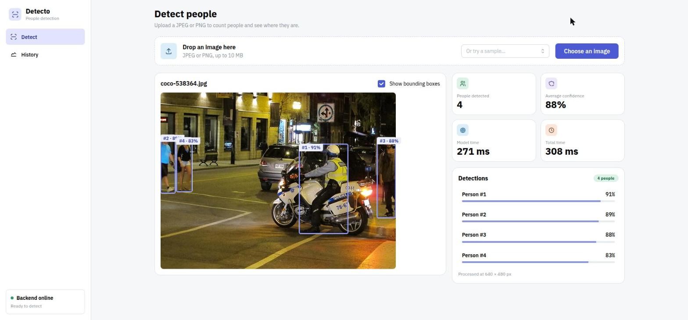

# Detecto

Detecto counts the people in an image. It draws a box around each person, shows how confident
the model is, and keeps a history of past detections that you can filter and chart over time.

It has a **FastAPI** backend that runs **YOLOv8s** (Ultralytics) on the CPU, and a
**React + Vite** frontend built with **Mantine**.

| Detect | History |
|---|---|
|  |  |



---

## Contents
- [Features](#features)
- [Architecture](#architecture)
- [Setup and run](#setup-and-run)
- [Tests](#tests)
- [Evaluation: methodology and results](#evaluation-methodology-and-results)
- [What worked, what could be improved](#what-worked-what-could-be-improved)
- [Known limitations](#known-limitations) (and [PRODUCTION.md](PRODUCTION.md): next steps for a real deployment)
- [Image credits](#image-credits)

## Features

**Detect page**
- Upload a JPEG or PNG by file picker or drag-and-drop, or pick one of 16 sample images
  from a searchable list.
- People are outlined with numbered boxes and their confidence. You can hover between the
  boxes and the list, or switch the boxes off.
- The page shows the people count, the average confidence, the model time and the total
  time (round trip).
- Errors are clear and instant. Empty, oversized and non-image files are caught in the
  browser before uploading, and the backend's own checks (format, corrupt file) are shown
  as-is.

**History page**
- Filter by From/To date and time (in your local time zone) and by a minimum confidence.
- KPI cards: detections, average people per frame, peak count, average model time.
- A "People over time" chart on a real time axis, and a paginated table.
- **Clear history** asks for confirmation and states the real scope ("Delete all N
  records"; it ignores the current filters and can't be undone).

**Backend**
- `POST /detect` takes a multipart image (`image` field) and returns
  `{count, detections: [{bbox, confidence}], average_confidence, inference_time_ms, image_width, image_height}`.
  Add `?return_annotated=true` to also get the image with boxes drawn on it (base64 JPEG).
- `GET /history` returns saved detections. It takes optional `start_date`, `end_date` and
  `min_confidence`.
- `DELETE /reset` clears the history. `GET /health` is a liveness check.
- Every error has a `{"detail": "<message>"}` body: 400 (missing, empty, corrupt or
  invalid input), 413 (too large), 415 (unsupported format), 500 (inference failure).
- Every detection is logged with its inference time and saved to SQLite.

## Architecture

```
 Browser (React + Mantine)                     FastAPI backend
 ┌─────────────────────────────┐   HTTP/JSON   ┌──────────────────────────────────────────┐
 │ DetectionView  HistoryView  │ ───────────▶  │ routes/detect.py   routes/history.py     │
 │   ImageUploader  FilterBar  │               │   │ validate (type, size, magic bytes)  │
 │   BoundingBoxOverlay        │ ◀───────────  │   ▼                                      │
 │   DetectionSummary  Chart   │               │ utils/preprocessing.py (resize, CLAHE)   │
 │ api/client.js (only module  │               │ services/detector.py (YOLOv8s, person)   │
 │   that knows the backend)   │               │ services/storage.py (SQLite)             │
 └─────────────────────────────┘               └──────────────────────────────────────────┘
```

How a detection flows:
1. The browser pre-checks the file and uploads it.
2. The backend validates the file by its real bytes, decodes it, resizes it to at most
   1280 px on the long edge, and boosts contrast on the luminance channel (CLAHE).
3. YOLOv8s runs, keeping only the `person` class above the confidence threshold.
4. The backend saves a summary record and returns the boxes in the coordinates of the
   processed frame.
5. The frontend draws the boxes as percentages of that frame, so they stay aligned at any
   display size.

The full design, API contract, storage schema and every decision are in
[`ARCHITECTURE.md`](ARCHITECTURE.md). The milestone log is in [`PROGRESS.md`](PROGRESS.md).

## Setup and run

Requirements: Python 3.12 and Node.js 20 or newer (developed on Node 24). No GPU is
needed; everything runs on the CPU.

### Backend
```bash
python3 -m venv backend/.venv
backend/.venv/bin/pip install -r requirements.txt          # add -r requirements-dev.txt for tests
backend/.venv/bin/python -m uvicorn backend.main:app --port 8000
```
- Run it from the project root. On first start, Ultralytics downloads the model weights
  (`yolov8s.pt`, about 22 MB) into the project root.
- The model is warmed up at startup, so the first request isn't slow.
- Settings live in `.env` at the project root:

| Variable | Default | Meaning |
|---|---|---|
| `MODEL_PATH` | `yolov8s.pt` | YOLO weights (`yolov8n.pt` is faster but less accurate; see the evaluation) |
| `CONFIDENCE_THRESHOLD` | `0.5` | A detection is kept if its confidence is above this |
| `DB_PATH` | `./backend/detecto.db` | SQLite file (relative paths resolve from the project root) |
| `CORS_ORIGINS` | `http://localhost:5173` | Allowed frontend origin(s), comma-separated |
| `MAX_UPLOAD_BYTES` | `10485760` | Upload limit (10 MB) |
| `WARMUP_MODEL` | `true` | Run one dummy inference at startup |

### Frontend
```bash
cd frontend
npm install
npm run dev            # http://localhost:5173
```
`frontend/.env` holds `VITE_API_BASE_URL=http://localhost:8000` and `VITE_MAX_UPLOAD_MB=10`.
The second must match the backend's `MAX_UPLOAD_BYTES`.

## Tests

```bash
backend/.venv/bin/python -m pytest                       # backend: unit + integration (real model)
backend/.venv/bin/python -m pytest -m "not integration"  # backend: fast unit tests only
cd frontend && npm test                                  # frontend: Vitest + Testing Library
```

Each milestone ended with a **testing gate** run by three Claude Code subagents
(`.claude/agents/`):
1. **test-planner** writes a test plan from the spec and lists every spec/code
   disagreement as an open question.
2. A human resolves those questions.
3. **test-generator** implements the plan as tests. Agreed changes are tested *before*
   they're built, so those tests fail first.
4. **test-healer** works out why each failure happens. It fixes test bugs and clear app
   bugs, escalates anything ambiguous, and never weakens a test.

The plans and healer reports are in [`test-plans/`](test-plans/). The gates caught real
bugs before they shipped, including:
- a crash on extreme aspect ratios;
- a date filter that silently returned nothing for years before 1000;
- a confidence filter that hid every empty-room record;
- several missing accessible names.

## Evaluation: methodology and results

### Test set
16 images from the **COCO 2017 validation set**. YOLOv8 was trained on COCO *train*, so
these images are new to it.
- They cover: one person, small groups, groups, crowds, partial occlusion, distant people,
  low light, and three images with **no people**, two of which are person look-alikes (a
  statue and a doll).
- Together they hold **69 visible people**.
- The images are in `backend/samples/` and `frontend/public/samples/`. The ground truth
  (COCO's person boxes, licence and source per image) is in
  `backend/samples/ground_truth.json`.

### Method (following the brief's definitions)
- **Visible persons:** COCO's person annotations (excluding crowd regions) whose box is at
  least 20 px tall in the original image. Smaller people are ignored: they count as
  neither missed nor false positives.
- **A correct detection** overlaps a visible person with an IoU of at least 0.5. Matching
  is greedy, highest confidence first, and each person can be matched once.
- **Detection accuracy** = correct detections ÷ visible persons.
- **False positives** = detections that match no person ÷ all detections, except those on
  ignored small people. A second box on an already-matched person (a duplicate) counts
  as a false positive.
- **Average confidence** = mean confidence of the correct detections.
- **Average inference time** = mean model time (`inference_time_ms`) over 3 runs per
  image, after warm-up.
- **System reliability** = images processed without error ÷ images sent.
- **Manual review:** I checked every error image by eye. Where a human would judge
  differently from the automatic IoU rule, the review column says why.

Each image goes through the real `/detect` pipeline (validation, preprocessing, model and
saving) with a temporary database:
```bash
backend/.venv/bin/python -m backend.scripts.evaluate    # writes backend/samples/results.json
```
Hardware: AMD Ryzen 5 5500U laptop CPU (no GPU), PyTorch 2.14 CPU, Ultralytics 8.3.40.

### Results (YOLOv8s, confidence threshold 0.5)

| Metric | Description | Target | Automatic (IoU ≥ 0.5) | After manual review |
|---|---|---|---|---|
| **Detection accuracy** | Correct detections ÷ visible persons | ≥ 85 % | **85.5 %** (59/69) | **87.0 %** (60/69) |
| **False positives** | Non-person detections | ≤ 10 % | **9.2 %** (6/65) | **7.7 %** (5/65) |
| **Average inference time** | Model time per image (CPU) | ≤ 1.5 s | **152 ms** (171 ms round trip) | — |
| **Average confidence** | Mean confidence of correct detections | ≥ 0.7 | **0.793** | — |
| **System reliability** | Images processed without errors | 100 % | **100 %** (16/16) | — |

<details>
<summary>Per-image results</summary>

| Image | Scenario | Visible | Detected | Correct | Missed | False pos. | Model time |
|---|---|---:|---:|---:|---:|---:|---:|
| coco-96493.jpg | single | 1 | 1 | 0 † | 1 † | 1 † | 151 ms |
| coco-473237.jpg | single | 1 | 1 | 1 | 0 | 0 | 153 ms |
| coco-252219.jpg | small group | 3 | 3 | 3 | 0 | 0 | 148 ms |
| coco-180560.jpg | small group, dim | 2 | 2 | 2 | 0 | 0 | 152 ms |
| coco-541055.jpg | group | 5 | 5 | 5 | 0 | 0 | 142 ms |
| coco-352684.jpg | group | 9 | 8 | 8 | 1 | 0 | 152 ms |
| coco-274460.jpg | crowd | 13 | 14 | 13 | 0 | 1 ‡ | 166 ms |
| coco-441543.jpg | dense crowd | 13 | 9 | 8 | 5 | 1 | 136 ms |
| coco-532690.jpg | occlusion | 3 | 4 | 3 | 0 | 1 | 185 ms |
| coco-392722.jpg | distant | 5 | 5 | 5 | 0 | 0 | 157 ms |
| coco-23899.jpg | low light | 3 | 2 | 2 | 1 | 0 | 150 ms |
| coco-389109.jpg | low light | 6 | 5 | 5 | 1 | 0 | 151 ms |
| coco-538364.jpg | low light | 5 | 4 | 4 | 1 | 0 | 162 ms |
| coco-34873.jpg | no people | 0 | 0 | 0 | 0 | 0 | 158 ms |
| coco-23751.jpg | statue (no people) | 0 | 1 | 0 | 0 | 1 | 147 ms |
| coco-180296.jpg | doll (no people) | 0 | 1 | 0 | 0 | 1 | 126 ms |

† The detection boxes the whole boy, including his arm and blanket. COCO's box is cropped
to his torso (IoU 0.45), so the automatic rule counts both a miss and a false positive. On
manual review it's a correct detection.
‡ This is probably a real, small background person that COCO didn't annotate. It's still
counted as a false positive, to stay conservative.
</details>

### Test cases and failures
- **Dense crowd under an umbrella (coco-441543):** 5 of 13 people missed. They're heavily
  occluded, often with only a head or shoulder visible. This is the largest single source
  of misses.
- **Low light (coco-23899, coco-389109, coco-538364):** one person missed in each. The
  missed people are both dark and partly hidden. Even with the contrast boost, these are
  the hardest cases.
- **Person look-alikes:** the **statue** (0.79) and the **doll** (0.55) are both detected
  as people. The model sees human shape, not life.
- **Occlusion at frame edges (coco-532690):** all 3 people found, plus one extra thin box
  on a partly visible body at the edge.
- **Lobby group (coco-352684):** 8 of 9. One person, mostly hidden behind another, was
  missed.
- **Worked well:** single people, small groups, skiers, the beach group (all 13), distant
  people (5/5), and the kitchen negative (0 detections).

### Model and threshold comparison
The project started on **YOLOv8n**, the smallest model. These runs led to switching the
default to **YOLOv8s**:

| Model @ threshold | Accuracy | False positives | Avg confidence | Model time |
|---|---|---|---|---|
| YOLOv8n @ 0.50 (original) | 75.4 % | 5.5 % | 0.772 | 62 ms |
| YOLOv8n @ 0.35 | 82.6 % | 17.4 % | 0.743 | 67 ms |
| YOLOv8n @ 0.25 | 85.5 % | 20.3 % | 0.728 | 66 ms |
| **YOLOv8s @ 0.50 (current)** | **85.5 %** | **9.2 %** | **0.793** | **152 ms** |
| YOLOv8s @ 0.35 | 89.9 % | 13.9 % | 0.773 | 155 ms |

- **Lowering the threshold on YOLOv8n** recovers people, but more than triples the false
  positives.
- **YOLOv8s** is the only setting tested that meets every target. It costs about 2× the
  inference time, which is still about 10× under the 1.5 s budget on a laptop CPU.
- **Data files:** each row comes from `backend/samples/compare-<model>-<threshold>.json`.
  The *current* row quotes `results.json`, the official run, and its timing differs
  slightly from the comparison run's (152 vs 154 ms) because timings vary run to run.
- **Caveat:** these settings were compared on the same 16 images they are reported on,
  and 69 people is a small sample. The 85.5 % only just clears the target, so treat it as
  indicative, not a guarantee.
- **Near-boundary detections:** one detection sits at confidence 0.502 (threshold 0.5) and
  one match at IoU 0.512 (matching needs 0.5). Results are identical across runs here, but
  a different CPU or library version could flip them. If the numbers change, re-run
  `evaluate` and update this table; the targets aren't loosened.

## What worked, what could be improved

**Worked well**
- Uncluttered scenes: single people, groups, and distant people in daylight.
- **Speed:** about 150 ms per image on a laptop CPU with YOLOv8s.
- **Reliability:** every image processed. The upload pipeline also rejects corrupt,
  empty, oversized and wrong-format files cleanly, and these cases are covered by tests.
- **Box alignment:** boxes are drawn as percentages of the processed frame, so they stay
  aligned through downscaling, EXIF rotation, extreme aspect ratios and window resizing.

**Could be improved**
- **Crowds and occlusion:** a larger model (YOLOv8m), or a crowd-specific dataset such as
  CrowdHuman for fine-tuning.
- **Look-alikes:** statues and dolls are detected as people. This would need context or
  liveness cues, or a confidence threshold tuned per deployment.
- **Low light:** stronger preprocessing (e.g. gamma or denoising before CLAHE), or a model
  fine-tuned on night images.
- **Evaluation size:** a larger held-out set (hundreds of images), with the threshold
  chosen on a separate validation split.
- **GPU:** inference would be much faster with CUDA, which isn't available on the test
  laptop.
- **Label collisions:** when boxes touch (e.g. two people at the frame edge in the night
  screenshot), their `#n · NN%` labels can overlap. A small layout pass could offset them.

## Known limitations
- **No authentication or roles:** anyone who can reach the API can call `DELETE /reset`
  and wipe the history. That's acceptable for a local demo, not for a deployment, which
  would need login, roles (only an admin can clear history) and an audit log.
- **Reset is a hard delete:** `/reset` removes the rows for good; there is no archive or
  retention policy.
- **Upload limit set twice:** `VITE_MAX_UPLOAD_MB` (frontend pre-check) must match
  `MAX_UPLOAD_BYTES` (backend). A test checks that the shipped values agree.
- **Base64 JSON input to `/detect`** (in the original brief) is deferred. Only multipart
  upload is implemented.
- **Time zone names:** on some Node/ICU builds, the History page names India's zone with
  its legacy alias "Asia/Calcutta".
- **Bundle size:** the frontend bundle is over 500 kB (Mantine, the date pickers and
  Recharts). The History page could be lazy-loaded.

These and the other steps from demo to production (HTTPS, non-blocking inference,
multiple cameras, PostgreSQL, monitoring, model drift) are written up in
[PRODUCTION.md](PRODUCTION.md).

## Image credits
The sample images are from the [COCO 2017](https://cocodataset.org) validation set and are
used under their Flickr Creative Commons licences (**CC BY 2.0** or **CC BY-SA 2.0**). Each
image's licence and original Flickr page are listed in
[`frontend/public/samples/CREDITS.md`](frontend/public/samples/CREDITS.md). The screenshots
above show these images with Detecto's overlays.
